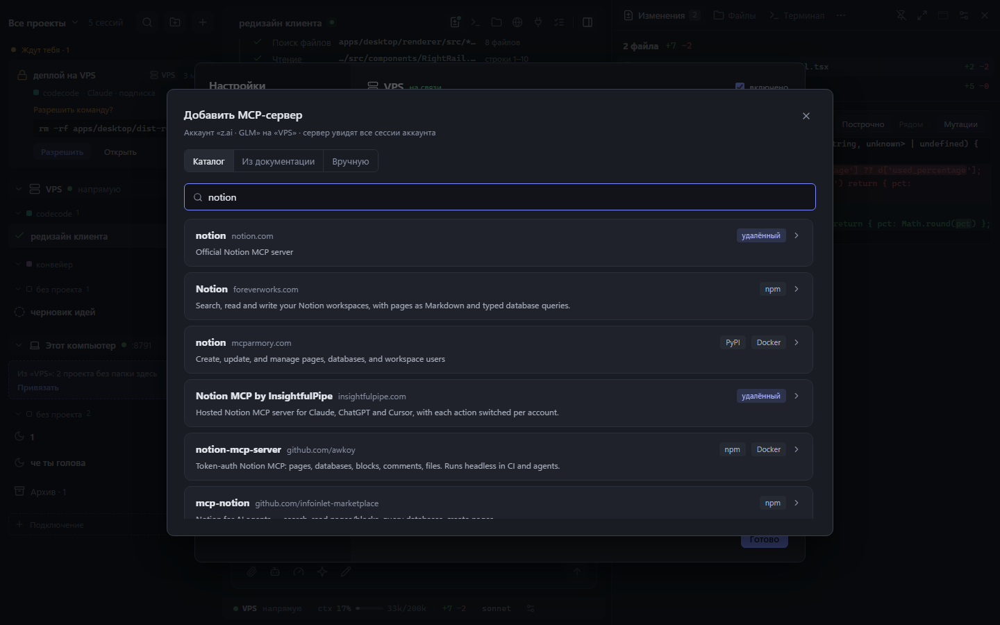
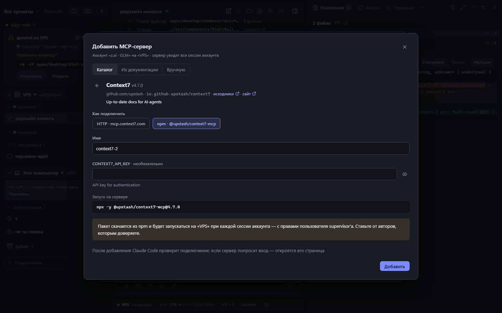
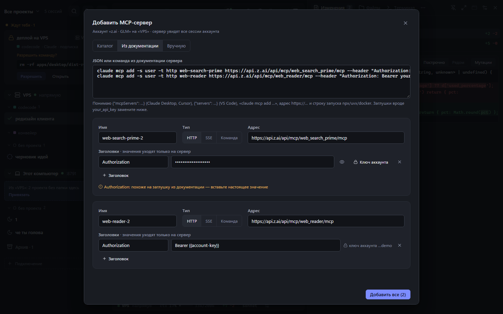

# Установка MCP-серверов (2026-11-12)

Настройки → подключение → «MCP» → «Добавить MCP-сервер». Три вкладки вместо прежнего зашитого списка.

## Каталог

Поиск по официальному каталогу MCP (registry.modelcontextprotocol.io — его ведут авторы протокола). Рядом с названием —
кто опубликовал: каталог проверяет, что имя принадлежит автору (его домен или аккаунт GitHub). Сервер самого сервиса —
первым, копии и платные обёртки — ниже.

Форма строится из записи: способ подключения (удалённый или пакет на сервере), имя, поля ключей. Для пакетов —
строка запуска и предупреждение: пакет скачается и будет запускаться на сервере. Если такой адрес уже подключён — подсказка.

## Из документации

Вставить то, что дают в документации сервиса: JSON (`mcpServers`, `servers`), команды `claude mcp add …`, адрес или
строку `npx …`. Несколько серверов — карточками, правятся до добавления. Заглушки вроде `your_api_key` подсвечиваются.
У аккаунта на шлюзе (z.ai) есть кнопка «Ключ аккаунта»: ключ подставит сервер, и только MCP-серверам домена шлюза.

## Вручную

HTTP/SSE (адрес и заголовки) или команда (аргументы и переменные окружения).
