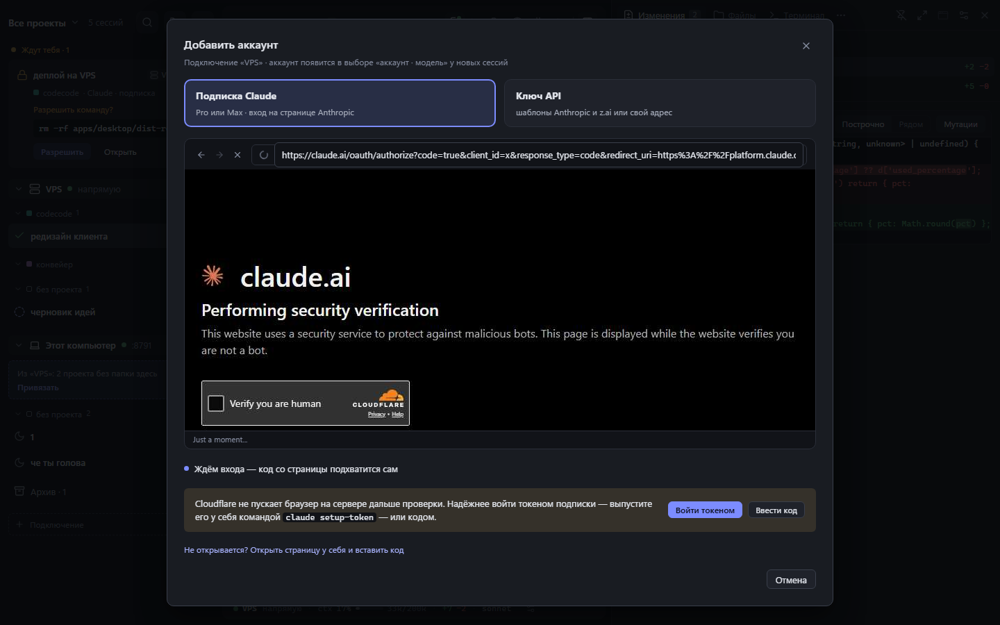
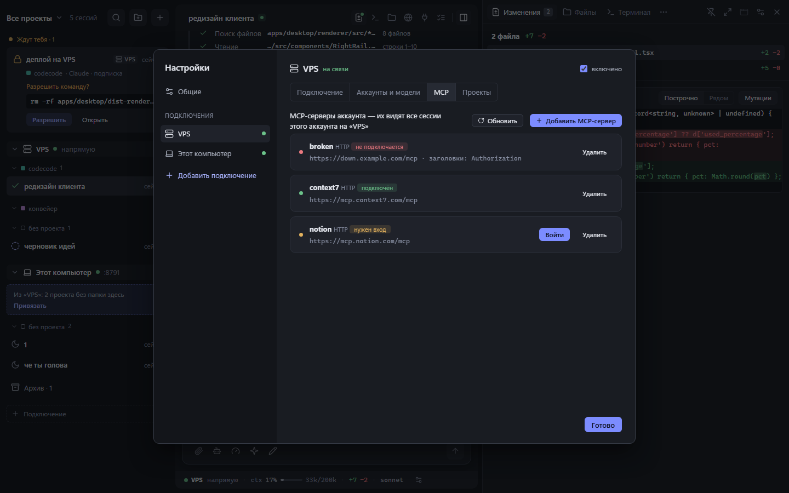
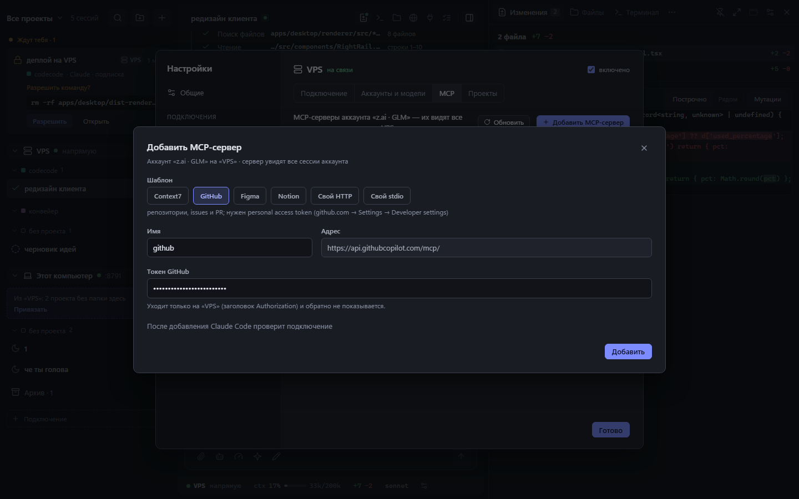
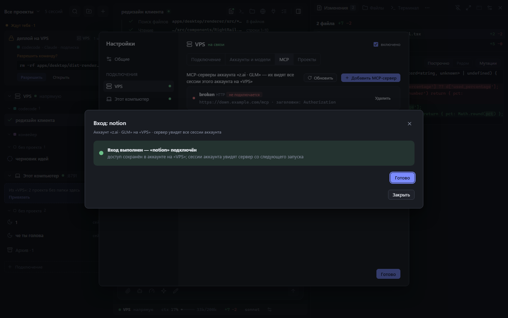
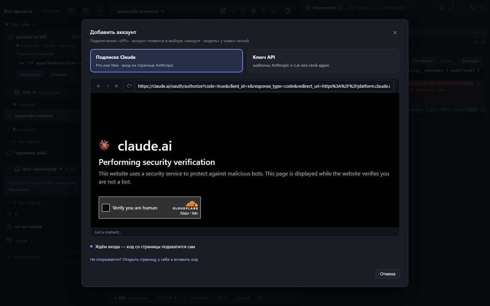

# Ночь 2026-11-12 — отчёт

Всё выкачено на Velohost (`203.0.113.62`), на сервере и локально — 461 тест, типы чистые. Откат последней выкатки:
`/home/yan/perimeter-prev-20261112-0139`. Решения ночи — в `docs/decisions.md` с пометкой «(ночь, делегировано)».

## 1. GLM «1211 Unknown Model» — причина найдена и устранена

Проверил подставным «шлюзом» (локальный HTTP-сервер вместо z.ai, ключи не нужны), что именно шлёт Claude Code:

| Модель в сессии | Уходит в z.ai |
|---|---|
| `glm-5.3[1m]`, `opus`, `default` | `glm-5.3` (приставку `[1m]` Claude Code отрезает сам и включает окно 1M) |
| `haiku` | `glm-5.3-flash` |
| **`fable`** | **`claude-fable-5-1`** → z.ai: «1211 Unknown Model» |

Claude Code подменяет на GLM только Opus / Sonnet / Haiku (по `ANTHROPIC_DEFAULT_*_MODEL`), а новая Fable уходит как есть.
Теперь у аккаунтов через шлюз в выборе модели — только подменяемые, с подписью модели шлюза: «glm-5.3 · 1M — вместо
Opus 5.5». Шаблон z.ai — на `glm-5.3[1m]` / `glm-5.3-flash[1m]` (по docs.z.ai), к ошибке 1211 — понятная подсказка.

## 2. Вход в подписку: подсказка, когда держит Cloudflare

Если страница входа на сервере дольше 10 с стоит на проверке Cloudflare — плашка «Войти токеном» / «Ввести код».

## 3. MCP-подключения — Настройки → подключение → «MCP»

Серверы аккаунта живут у самого Claude Code (`claude mcp … -s user` в папке аккаунта); статус — из `claude mcp list`.

Добавление — шаблоны Context7, GitHub, Figma, Notion, свой HTTP, свой stdio; секреты только уходят на сервер,
в список возвращаются имена заголовков и переменных.

Вход OAuth (Figma, Notion…) — как у аккаунтов: страница сервиса во вкладке браузера на сервере, возврат на localhost
сервера Claude Code ловит сам; запасной путь — открыть у себя и вставить адрес возврата.

Живая проверка на Velohost (аккаунт «По умолчанию»): Context7 добавлен → «подключён» → удалён, настройки вернулись как были.
Проектный уровень (`.mcp.json` проекта) — позже, записано в открытые развилки.

## 4. Прочее

- Инструмент скриншотов без панели браузера: `packages/supervisor/scripts/ui-shot.ts` (Chrome без окна по CDP, сценарий-JS).
- Окно «Добавить аккаунт» — для справки, как выглядит вход через браузер на сервере: 

## Что нужно от тебя

1. **Перезапустить приложение** — локальный supervisor («Этот компьютер») подхватит фильтр моделей GLM и подписи только после перезапуска.
2. **GLM на этом компьютере** — выбери модель «glm-5.3 · 1M»; Fable у аккаунта GLM больше не предлагается.
3. **MCP на velohost** — попробуй, например, Context7 (без ключа) или Figma (с входом).
4. **Поставка без исходников** — разбор вариантов с ценой: [docs/design/delivery-options.md](../design/delivery-options.md). Рекомендую «как VS Code Remote SSH»: приложение само ставит и обновляет supervisor на сервере по ssh. Нужен твой выбор.
